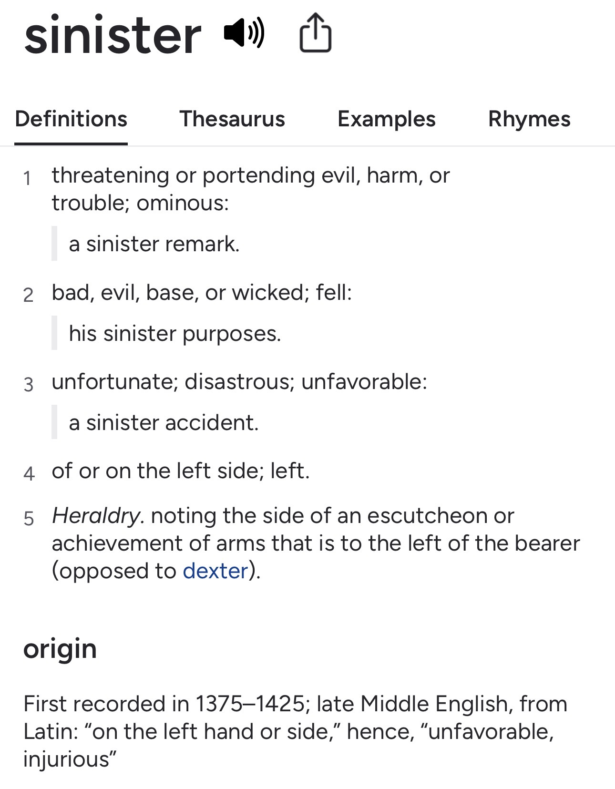

Title: Southpaw
Date: 2026-10-11
Category: notes
Tags: notes

Igbo people call the right hand _**aka nni**_, or “the hand for food”, and the left **_aka ekpe_**. I always thought that was funny because my hand for food has always been my left hand.
Going through life as left handed person, you accumulate a few fun stories.

Apparently, when I started out in nursery at Nitel Staff school the teachers complained that I was slow, couldn’t write and should be brought back when I was older.

> “What hand were you making him write with? Don’t force him to use any hand, just allow him to write with whatever hand he wants to” - my Mom.

I won the most prizes in my graduating class at Nitel, so I must have done okay at school after that.

In secondary school I recall getting insulted by one of the snack vendors at break time for handing over my money with my left hand, and another time during NYSC where some man at an administrative desk for some line I was in doubled down to confirm, that I was abnormal for using my left hand.

Most interestingly, on a flight from Lagos to Abuja one time in my mid-20’s, this lady with an accent on the other aisle noticed me taking notes and said that was ‘sinister.’ When I pushed back on how writing could be sinister, she said to look up the etymology of the word. 
To my surprise, in addition to other ominous meanings it did mean left-sided.

Speaking of fun facts, it’s a nice twist when people I’ve known for a while see me writing and learn that I’m left handed.

Some say being southpaw makes us think differently from others, but here’s one actual advantage I noticed. When I started training may Thai 8 years ago, I realized being left handed meant I had a difference stance from most people. 
Consequently, a lot of people had never paired up with someone who didn’t fight in the orthodox stance, so were at a disadvantage when sparring with me. On the other hand I had to get more used to the orthodox style, even if just to translate the Kru’s moves to my own stance.

And if that ain’t the story of a south paw in an orthodox world. Things aren’t really designed for you, so you just get on with it. Imagine how people with real disabilities are faring.

One of these accepted conventions driven by right handers is the handshake. All around the world people have accepted it as common to greet by shaking each other with their hand, but I think that’s a bit gross because it’s the hand you use to touch everything else, including what goes in your mouth.

What hand do you use to wipe in the bathroom? 

I find it a hilarious twist of fate, that southpaws go around touching people and things with *that hand*, while keeping our aka nni relatively pristine and germ free for eating 🙂 

